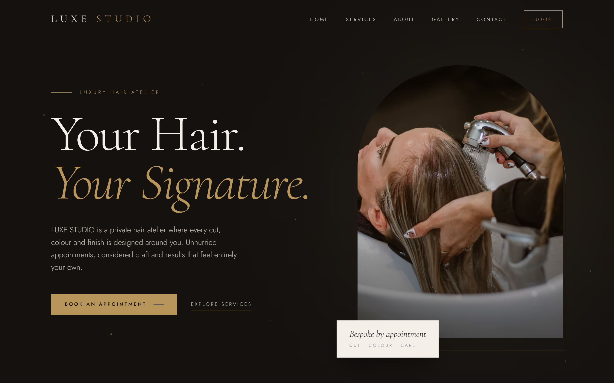

# LUXE STUDIO

A premium, editorial-style website for a fictional luxury hair salon. Built as a portfolio project to practise modern React, responsive design and motion.

**Live site:** [luxe-studio-eight.vercel.app](https://luxe-studio-eight.vercel.app)

> All names, prices, reviews and contact details are **sample content** for demonstration. Nothing here is a real business.

## Screenshots

## Screenshots




## Features

- Responsive layout for phone, tablet and desktop
- Navigation bar that becomes solid on scroll, with a full-screen mobile menu
- Hero with a mouse-driven 3D tilt, scroll parallax and floating gold particles
- A real-time 3D gold object (Three.js) that turns as you scroll. It is lazy-loaded and only shown on desktop-width screens, so phones never download it. It is also skipped for visitors who prefer reduced motion, and fails silently if WebGL is unavailable.
- Services menu with prices, driven from a single data list
- Editorial photo gallery with hover tilt and zoom
- About section, testimonials and contact section with opening hours
- Booking form with full validation (name, email, phone, service, date and time) and clear error messages
- Accessible by design: labelled form fields, keyboard focus handling, and animations that tone down for visitors who prefer reduced motion

### How the booking form works

There is no backend. After the form passes validation, it opens **WhatsApp with the booking details pre-filled**, and the visitor presses Send. The form states clearly that nothing is booked until the salon replies. It does not send email or store any data.

## Built with

- [React](https://react.dev/)
- [Vite](https://vite.dev/)
- [Tailwind CSS](https://tailwindcss.com/) v4
- [Framer Motion](https://motion.dev/)
- [Three.js](https://threejs.org/), [React Three Fiber](https://r3f.docs.pmnd.rs/) and [drei](https://github.com/pmndrs/drei) for the 3D hero object
- JavaScript (ES modules)
- Google Fonts: Cormorant Garamond and Jost

## Getting started

You need [Node.js](https://nodejs.org/) version 20.19 or newer.

```bash
# 1. Clone the repository
git clone https://github.com/Anopa21/luxe-studio.git

# 2. Move into the project folder
cd luxe-studio

# 3. Install the dependencies
npm install

# 4. Start the development server
npm run dev
```

Then open the address shown in the terminal, usually `http://localhost:5173/`.

To create a production build:

```bash
npm run build
```

## Customising the content

Contact details, opening hours, social links and the WhatsApp number live in one file: `src/siteConfig.js`. The services and prices are at the top of `src/components/Services.jsx`. All values are placeholders.

## Project structure

```
src/
├── components/   Navbar, Hero, Services, Gallery, About,
│                 Testimonials, Booking, Contact, Footer, Button, Tilt,
│                 Hero3D (loads the 3D only when needed), GoldObject (the scene)
├── siteConfig.js Contact details and settings
├── App.jsx       Page layout
├── main.jsx      App entry point
└── index.css     Tailwind and design tokens (colours and fonts)
public/images/    Site photos
```

## Photo credits

All photographs are from [Unsplash](https://unsplash.com/) and used under the Unsplash licence. Thank you to:

Toan Le, Vinicius Amnx Amano, Cassio Jardim, Ramon Benitez, Tile Merchant Ireland, Hadis Safari and Lindsay Cash.

## Author

Built by [Anopa Machipisa](https://github.com/Anopa21).